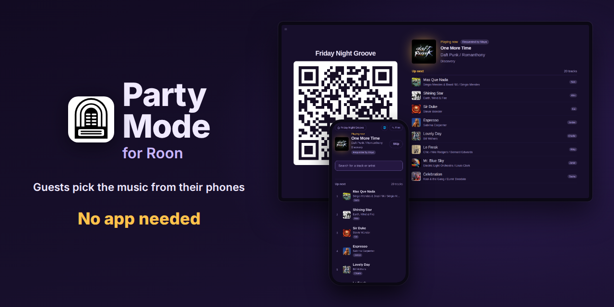

<p align="center">
  
</p>

# Party Mode for Roon

*A Roon Extension for parties: guests request music from their phone, no app needed.*

Let your guests pick the music. They scan a QR code with their phone, search your Roon
library and streaming services, and add tracks to the party's queue. No app to install, no
Roon account, and no access to anything else in your Roon setup.

- **Guests add, play next or skip tracks** from their phone.
- **Fair shares:** limit how many of each a guest gets, with more added back over time.
- **Names on tracks:** guests can give a nickname, shown next to the tracks.
- **The Party Hub** for a TV or tablet: QR code, what's playing and what's up next.
- **Pass it on:** guests tap the party's name on their phone to show the QR code, with no
  need to find the Party Hub.
- **Up next and Played** lists, so everyone can see what's coming and what's been on at
  this party.
- **Keep the party's playlist:** download everything that was queued as a spreadsheet
  file, ready to import into a music service.
- **Your own Party Hub:** build a screen of your own (see
  [Your own custom Party Hub page](#your-own-custom-party-hub-page)).
- **In their language:** 30 languages. Each phone shows its own, and the Party Hub
  follows its screen or a language you choose (see [Languages](#languages)).

What's changed in each version is in [RELEASES.md](RELEASES.md).

## What you need

- A Roon Core.
- A computer on the same network to run the extension: a 64-bit PC or NAS, or a
  Raspberry Pi from 2014 or later with at least 512 MB of memory.
- Linux and Docker on that computer (see [Installing](#installing)).
- Guests' phones on the same Wi-Fi as that computer: iOS 10.3 or later, or Android with
  Chrome 55 or later (Chrome updates from the Play Store on almost any Android phone).
- For the Party Hub, any screen with a web browser (see
  [Showing the Party Hub on a TV](#showing-the-party-hub-on-a-tv)).

## Installing

On Linux, including a Raspberry Pi with DietPi, the setup program is the easiest way.
Otherwise, or if you'd rather, install manually.

### With the setup program (Linux and DietPi)

The setup program installs Party Mode with Docker or with the Extension Manager. Before
you run it, install the one you'd like to use:

- **Docker:** on DietPi, choose **Docker** in `dietpi-software`; elsewhere see
  [Install Docker Engine](https://docs.docker.com/engine/install/).
- **Extension Manager:** on DietPi, choose **Roon Extension Manager** in `dietpi-software`
  (it installs Docker too); elsewhere see
  [Install Extension Manager](https://github.com/TheAppgineer/roon-extension-manager/wiki/Installation).

Download it and run it in one go:

```bash
curl -fsSLO https://raw.githubusercontent.com/stubaggs/roon-extension-party-mode/main/party-mode-setup.sh && bash party-mode-setup.sh
```

Or save [`party-mode-setup.sh`](https://raw.githubusercontent.com/stubaggs/roon-extension-party-mode/main/party-mode-setup.sh) to the computer, then run it from that
folder:

```bash
bash party-mode-setup.sh
```

Choose **With Docker** or **With the Extension Manager**, then **Install Party Mode**, and
follow its steps. With the Extension Manager, finish in Roon: open **Settings →
Extensions** and install Party Mode with the Extension Manager.

Run it again whenever you want to check, update or uninstall Party Mode.

Then see [Starting a party](#starting-a-party).

### Installing manually

Choose one way. If the Extension Manager runs Party Mode on this computer, don't also run
it with Docker: the Manager can't install or update Party Mode beside it. On different
computers, they're fine.

<details>
<summary><strong>On a NAS with Docker support</strong></summary>

On a Synology with DSM 7.2 or later, install **Container Manager** from Package Center,
then run Party Mode as a project. Its settings are kept through updates, with nothing to
set up:

1. Download Party Mode's
   [`docker-compose.yml`](https://raw.githubusercontent.com/stubaggs/roon-extension-party-mode/main/docker-compose.yml).
2. In Container Manager, choose **Project → Create**. Give it a name such as
   `party-mode`, and for **Path** create a folder for it, for example
   `docker/party-mode`.
3. For **Source**, choose **Upload docker-compose.yml** and pick the file you downloaded.
   (Or choose **Create docker-compose.yml** and paste the file's contents.)
4. Press **Next**, skip **Web portal settings**, tick **Start the project once it is
   created** if it isn't already, and press **Done**. Container Manager downloads Party
   Mode and starts it.

To update, select the project and choose **Action → Stop**, then **Action → Build**,
with **Start the project once it is created** ticked. Build downloads the new version and
keeps your settings. (Don't use **Clean**: it deletes them.)

On other NAS Docker apps and older DSM, search the app's registry for
`stubaggs/roon-extension-party-mode`, download the **latest** tag, and create a container
from it. Set the network to **host** (with **bridge**, Roon can't find Party Mode) and
tick **Enable auto-restart**. Party Mode then keeps its settings inside the container, so
recreating it, for example to update, means enabling it in Roon and choosing its
settings again.

Then see [Starting a party](#starting-a-party).

</details>

<details>
<summary><strong>With Docker</strong></summary>

On Linux, including a Raspberry Pi, install Docker with its Compose plugin (on DietPi,
choose **Docker** and **Docker Compose** in `dietpi-software`; elsewhere see
[Install Docker Engine](https://docs.docker.com/engine/install/)).

Then make a folder for Party Mode, download
[`docker-compose.yml`](https://raw.githubusercontent.com/stubaggs/roon-extension-party-mode/main/docker-compose.yml)
into it, and start it:

```bash
mkdir roon-extension-party-mode && cd roon-extension-party-mode
curl -O https://raw.githubusercontent.com/stubaggs/roon-extension-party-mode/main/docker-compose.yml
docker compose up -d
```

Then see [Starting a party](#starting-a-party).

In Party Mode's folder, to update to the latest version:

```bash
docker compose pull && docker compose up -d
```

To stop it:

```bash
docker compose stop
```

To start it again after a stop:

```bash
docker compose start
```

Your settings and Roon's pairing are in a Docker volume, so updating keeps them.

<details>
<summary><strong>Prefer <code>docker run</code>?</strong></summary>

This does the same as `docker-compose.yml`, and needs only Docker, not the Compose plugin:

```bash
docker run -d --name roon-extension-party-mode --network host --restart unless-stopped \
  --log-driver json-file --log-opt max-size=10m --log-opt max-file=3 \
  --read-only --memory 512m --cap-drop ALL --security-opt no-new-privileges \
  -v roon-extension-party-mode-data:/data \
  stubaggs/roon-extension-party-mode:latest
```

Then see [Starting a party](#starting-a-party).

To update to the latest version, run these, then the command above again:

```bash
docker pull stubaggs/roon-extension-party-mode:latest
docker rm -f roon-extension-party-mode
```

To stop it:

```bash
docker stop roon-extension-party-mode
```

To start it again:

```bash
docker start roon-extension-party-mode
```

Once stopped, it stays stopped, even after a restart of the computer, until you start it
again.

</details>

</details>

## Starting a party

1. In Roon, open **Settings → Extensions**, press **Enable** next to **Party Mode** if it
   isn't enabled yet, then press its **Settings**. Under **Party setup**, pick the party's
   **Zone**: where the music plays. Everything else is optional.
2. To change what guests can do, and how often, open **Guest requests** (see
   [Settings](#settings)).
3. Press **Save** to apply your choices.
4. Click **Party Mode**'s link in the Extensions list to open its About page, then press
   **Open the Party Hub** (or **Copy** its address for another screen). Put the Party Hub
   on a TV, a tablet or a laptop where guests can see it (see
   [Showing the Party Hub on a TV](#showing-the-party-hub-on-a-tv)).
5. Guests scan the QR code on the Party Hub with their phone camera. That's it.

**Party**, at the top of the settings, runs the party:

- **On**: guests can make requests. Switching to On or Paused from **Off** starts a new
  party and a new playlist. Guests' pages let them back in by themselves.
- **Paused**: for a speech or the cake. Choose **Pause**: playback pauses and guests'
  requests wait. Choose **Unpause** to carry on where you left off. Pausing only in Roon
  isn't enough: a guest's next request starts playback again.
- **Off**: when you're done taking requests. Playback pauses, guests can't make requests,
  and the playlist is ready to download.

Under **Settings → Extensions**, Roon shows Party Mode's status: its Party state, the
party's name, the zone, the Party Hub's address and the playlist's, for example:

> Party: Paused<br>
> Name: House Party<br>
> Zone: Living Room<br>
> Hub: `http://192.0.2.10:8338/PartyHub`<br>
> Playlist: `http://192.0.2.10:8338/p/7KQ4-M9XD`

## Showing the Party Hub on a TV

The Party Hub is a web page. Its address is in Party Mode's status in Roon (above) and on
the About page; open it on any device on the same network as Party Mode:

- **The TV's own browser,** or a browser app on a Fire TV or Google TV stick. Bookmark the
  address. Nothing else has to stay on, so this is the most reliable. Turn off the TV's
  screen saver for the party.
- **Chromecast or Google TV, from a computer:** in Chrome, choose **Cast…** from the menu,
  pick the TV and cast the tab, then make it full screen (F11, or Ctrl+Cmd+F on a Mac).
  The computer has to stay on, with the tab open.
- **Apple TV or an AirPlay TV, from an iPhone, iPad or Mac:** open the Hub in Safari and
  choose **Screen Mirroring** in Control Centre. Turn an iPhone or iPad sideways, plug it
  in and set **Auto-Lock** to **Never** (**Settings → Display & Brightness**).
- **A laptop** plugged into the TV with HDMI, with the Hub in full screen.

**Choosing the view.** **Party Hub default view** in the [settings](#settings) decides
what `/PartyHub` shows. Any screen can show a different view by adding it to the address:
`/PartyHub/Standard`, `/PartyHub/Roon` or `/PartyHub/Basic`.

**Older TVs.** If the Hub doesn't look right on a TV's browser, use `/PartyHub/Basic`: a
simpler 16:9 page with the same QR code, what's playing and Up next. A browser too old for
the Party Hub is sent there automatically.

**Roon Display** (`/PartyHub/Roon`, or as the default view): each screen showing it
appears in Roon as a display device, named after its browser (such as "Chrome on Linux").
Once for each screen, tie it to the party zone: in Roon, click the zone's volume control,
pick **Displays** and choose it. The screen has to reach the Roon Core too; until it can,
the Hub shows its own view.

## The party's playlist

Once **Party** is **Off**, the Party Hub offers the playlist to download, unless
**Playlist** is **Off** (see [Settings](#settings)). Its address is also in Party Mode's
status in Roon; open it in any browser on your network. Each party's playlist has its own
address, so only people you give it to can download it, and the old one stops working when
the next party starts.

It's a CSV file of every track queued in the party zone, numbered, with title, artist,
album, length, who asked for it and when. To leave guests' nicknames out, turn on **Hide
names in downloadable playlist** under **Advanced**. Roon can't import it directly, but
[Soundiiz](https://soundiiz.com) can: choose **Import playlist**, then the file, and pick
the streaming service you use with Roon (TIDAL, Qobuz or KKBOX). Roon then shows it with
your other streaming playlists.

## Settings

Only **Party** shows when you open the settings; the rest is in groups you open when
you need them.

### Party

On, Paused or Off (see [Starting a party](#starting-a-party)).

### Party setup

| Setting | What it does |
| --- | --- |
| Zone | Where the music plays. If you pick a speaker that's grouped with others, the whole group plays. |
| Roon profile | The Roon profile guests' tracks play under, so they count toward its play history and recommendations. Unless you choose one, that's Roon's default profile (normally **Guest**). To keep a record of the party, create a profile such as "Party" in Roon first, then choose it here. |
| Name | The party's name, shown on the Party Hub and guests' pages. |
| Host name | Your name in place of **Host**, up to 24 characters. Guests can't use it as their name. |
| Invites | Whether guests can show the QR code on their phone. On by default; off, only the Party Hub has it. |
| Party Hub default view | What `/PartyHub` shows: **Standard** (the default), **Roon Display** or **Basic** (see [Showing the Party Hub on a TV](#showing-the-party-hub-on-a-tv)). |
| Party Hub language | The language of the built-in Party Hub, for every screen showing it. Guest phones follow their own language settings. |
| Playlist | How the Party Hub offers the playlist once **Party** is **Off**: a **QR code**, a **Link only**, or **Off**. |

### Guest requests

| Setting | What it does |
| --- | --- |
| Block tracks already in the queue | Whether a track already in the queue can be added again, either way of adding. Covers, live takes, remasters and the same track on another album count as different tracks. |
| Add to queue | Whether guests can add tracks to the end of the queue. |
| "Add to queue" per guest | How many tracks each guest can add: 5 by default. |
| One more every (minutes) | How often a guest gets another: every 10 minutes by default. |
| Play it next | Whether guests can put a track straight after the one playing. |
| "Play it next" per guest | How many times each guest can: once by default. |
| One more every (minutes) | Every 60 minutes by default. |
| Skip tracks | Whether guests can skip the track playing now. Off unless you turn it on. |
| "Skip" per guest | How many times each guest can: once by default. |
| One more every (minutes) | Every 60 minutes by default. |

**Add to queue**, **Play it next** and **Skip tracks** are separate: allow any of them, in
any combination. In the counts, 0 means no limit; in the minutes, 0 means never. Changing
these during a party applies straight away to guests already there, counting what
they've used.

### Advanced

Logging, playlist privacy, network and Roon menu names.

<details>
<summary><strong>Advanced settings</strong></summary>

| Setting | What it does |
| --- | --- |
| Detailed log | For troubleshooting (see [Getting help](#getting-help)). |
| Hide names in downloadable playlist | Guests' names become **Anon** in the playlist. Tracks Roon Radio picked or you queued still say **Roon Radio** or **Host** (or your **Host name**). Off by default. |
| Web port | 8338 unless it's busy the very first time Party Mode starts, when it takes the next free one and keeps it. Only change it if something else on the computer uses that port. After you save a new port, Party Mode reconnects to your Core so Roon shows the new link: it disappears from Roon's Extensions list for up to a minute, then comes back by itself. Pages already open, and phones, need the new link or a fresh scan. |
| Flood protection | So one misbehaving device can't overwhelm Party Mode or your Core. **Default** suits almost everyone. How high **Custom** is useful depends on your network, your Core and the computer running Party Mode. |
| Roon menu names | See [Installing and Roon](#installing-and-roon) under Troubleshooting. |

</details>

## Good to know

- **Keep it at home.** Anyone on your network can join and add tracks, and the Party Hub
  needs no login at all. Don't open the port to the internet.
- **Keep the QR code the same, party after party,** by reserving the address of the
  computer running Party Mode in your router's settings (often called a DHCP reservation
  or a fixed IP address). The code leads to `/GuestHub` at that address, for example
  `http://192.0.2.10:8338/GuestHub`, so if the router gives the computer a new address,
  the code changes. With the address reserved, you can print the code, and guests'
  bookmarks and home-screen icons open straight in at the next party.
- **Guests can't rearrange the queue.** They can add a track to the end, or play one next
  when they add it, but Roon doesn't yet let anyone move a queued track.
- **A radio station waits for you.** While a live radio station plays on the party zone,
  guests can still add tracks, but they won't play until you switch over: in Roon, open
  the party zone's queue and choose **Play from here** on the track to start with.
- **Tag colours** show how a track got into the queue: **lavender** when a guest added it,
  **amber** when a guest chose **Play it next**, **mint** for Roon Radio, and **sky blue**
  for **Host** (or your **Host name**), anything you queued in Roon. The Roon Radio
  tag is a good guess: a track you add just as the last one ends may get it.
- **Guests' nicknames:** guests can't call themselves Host, Roon Radio, Radio or Anon, in any
  language, or your **Host name**.
- **Download the playlist before** restarting the extension, changing the party zone or
  switching **Party** to On or Paused from **Off**: each of those starts a new
  playlist. It keeps up to 5000 tracks, guests' requests longest.
- **The playlist has guests' nicknames in it.** With **Playlist** set to **QR code**,
  anyone at the party can keep a copy once it's over. If that's not what you want, turn
  on **Hide names in downloadable playlist** under **Advanced**, or choose **Link only**
  or **Off**: with **Off**, only you have the address, in Party Mode's status in Roon.
- **Big parties need capable hardware.** Guests' searches run on your Roon Core, and
  Party Mode serves their pages and album art. In tests with 500 tracks queued and every
  guest searching every couple of minutes:
  - On a PC or a Raspberry Pi 3 B+, Party Mode handled 200 guests with searches taking
    about a second, even with Roon limited to one processor core of a 2018 Intel i9.
    That one core kept up with about two searches a second; most Roon Core computers
    have several.
  - On a Raspberry Pi 1, Party Mode was comfortable with 30 guests and slowed down
    after 50.

  A slower Core, a very large library or many guests searching at once can reach the
  Core's limit sooner. If searches get slow, the Core or the computer running Party Mode
  is at its limit: see **Searches are slow** under
  [During the party](#during-the-party).

## Troubleshooting

### Installing and Roon

**Not sure what's installed, or how?** On Linux, run the
[setup program](#installing) and choose **Status**.

**The Extension Manager stays at "Installing: Party Mode…".** Party Mode also runs with
Docker on that computer, and the Manager can't finish beside it. Run the
[setup program](#installing) and choose **Fix**, or uninstall the copy run with Docker.

**Docker says "permission denied".** Your user isn't set up to use Docker. Put `sudo` in
front of each `docker` command.

**Party Mode doesn't appear in Roon's Extensions list.** The computer running it must be on
the same network as the Roon Core, and Docker must use the host network (`network_mode:
host` in `docker-compose.yml`, `--network host` with `docker run`). If your Docker doesn't
support [host networking](https://docs.docker.com/engine/network/drivers/host/), use a
Linux computer, a Raspberry Pi or a NAS. After you disable or unauthorize Party Mode, or
restart the Roon Core, it can take up to a minute to appear again.

**Roon says settings can't be saved.** The extension has nowhere to keep them. Check that
`docker-compose.yml` still has its `party-mode-data:/data` volume line, or that your
`docker run` command has `-v roon-extension-party-mode-data:/data`. If you mount a
`config.json` file instead, it must be writable:

```bash
sudo chown 1000 config.json && chmod 600 config.json
```

Once it's fixed, press **Save** in Party Mode's settings: the warning clears, with no
restart.

**Party Mode is new in Roon again after an update.** Its settings were kept inside the
old container. Enable it and choose its settings again.

**Roon's status says a port is in use, in red.** Another app, or another copy of Party
Mode, is using Party Mode's **Web port**, so the guest pages and the Party Hub can't
start. Stop the other one, or choose another port under **Advanced** in the settings.
Party Mode never moves to another port by itself, except on its very first run, when it
takes the next free one after 8338 and keeps it.

**Roon's status says it could not open a port (EACCES).** Ports below 1024 need special
permission, which Party Mode doesn't have. Choose a **Web port** from 1024 up, such as
the default 8338.

**Search finds nothing, or adding fails, on a Core in a language other than English.**
Under **Advanced** in the settings, fill in the **Roon menu names** your Core uses.

### Guests

**Phones can't open the page after scanning.** Check that the phones are on the same
Wi-Fi as the computer running Party Mode, and that the computer's firewall allows the port
shown in Roon's status line (8338, unless you chose another or it was busy).

**A guest's page says "Scan the code again".** Their browser blocks cookies (some private
modes do). Allowing cookies for the Party Hub's address lets them in. Party Mode's cookie
only holds a random code that tells their phone apart, for 12 hours, plus a language
they pick: nothing is tracked or shared.

**A guest's page stays blank.** Their phone's browser is too old: the guest page needs
iOS 10.3 or later, or Chrome 55 or later on Android. On Android, updating Chrome from the
Play Store usually fixes it.

**Guests can't join, and Roon shows Party Mode's address as `127.0.0.1`.** The QR code
and links point at the computer itself, which phones can't reach. It happens after the
computer restarts, when Party Mode starts before the network is up. Restart Party Mode
once:

```bash
docker compose restart                              # Docker Compose, in its folder
docker restart roon-extension-party-mode       # docker run
```

In Synology's Container Manager, stop Party Mode's project and start it again.

**A guest sees "Too many requests".** Guests reaching Party Mode through one shared
address (some guest networks and extenders) count as one device. Set **Flood protection**
under **Advanced** to **Custom** and raise the numbers.

**There's no Skip button.** **Skip tracks** is off in the settings, a radio station is
playing, or it's the last track with Roon Radio off, so there's nothing to skip to.

**Guests can't change the volume.** That's on purpose: Party Mode never gives guests
volume control. Set the party zone's volume in Roon. If the zone has no volume control in
Roon (fixed volume, or an amplifier controlled on its own), set it on the amplifier.

### During the party

**Guests see "Requests are paused for a moment", but you didn't pause the party.** The
party zone isn't available in Roon (its device is switched off, unplugged or asleep), or
your Roon Core is restarting or can't be reached. Roon's status line for Party Mode says
which. Requests come back on by themselves as soon as the zone and the Core are back. If
the zone stays away, check the device, or choose another **Zone** under **Party setup**.

**A change in the settings didn't stick.** Roon closes the settings window when you press
**Save**, even if a value can't be saved, such as a **Host name** over 24
characters. Party Mode's status under **Settings → Extensions** then says what wasn't
saved, in red. Open the settings, fix it and press **Save** again.

**Searches are slow.** Check **Search time** and **CPU use** on the About page (see
[Reading the About page](#reading-the-about-page)).

### Reading the About page

The About page (click **Party Mode**'s link in Roon's Extensions list) shows how Party Mode
and the party are doing. Most of it explains itself; these rows help when something isn't
right. Counts are since Party Mode last started.

| Row | What it shows | Worth a look when | What to do |
|---|---|---|---|
| **Connection lost**, **Last lost** | How often Party Mode lost touch with the Core, and when it last did, for how long. | It happens without anyone restarting or updating Roon. | Check the network between the Core and the computer running Party Mode: a wired connection is best for both. |
| **Search time** | How long your Core takes to answer a search: typical, and the slowest. | Typical is several seconds. | The Core is busy: let it finish other work, such as a library scan. For big parties, a faster Core helps. |
| **Tracks requested**, **Searches**, **Skips** | How many there were, and how many Roon couldn't do (**failed**). | Many failed. | Check that the tracks play in Roon, and that your streaming service is signed in. |
| **Allowances used up** | How often guests were turned away with none left, for each kind. | It's high. | Raise the limits or shorten the refresh under [Guest requests](#guest-requests). |
| **CPU use**, **Processing delay** | How hard the computer running Party Mode is working: its share of one processor, and how long it was too busy to answer (**0 ms typical** is normal). | CPU use stays near 100%, or the slowest delay is in the hundreds of milliseconds. | The computer running Party Mode is at its limit: stop other heavy work on it, or run Party Mode on a faster one. |
| **Live update reconnects** | How often a guest's page or the Party Hub lost its live updates and picked them up again. A few per guest is normal: phones lock and wake. | It climbs quickly while people are using it. | Check the Wi-Fi coverage where guests and the Party Hub are. |

### Getting help

**Something else isn't working.** Turn on **Detailed log** under **Advanced**, try again,
then inspect the log:

```bash
docker compose logs -t                              # Docker Compose, in its folder
docker logs -t roon-extension-party-mode       # docker run
```

With the Extension Manager, use its **Collect Logs**. Turn the detailed log off again
afterwards: it's large and records what guests search for.

**Need help, or have a suggestion?** Ask on the
[Roon forum](https://community.roonlabs.com/t/party-mode-extension).

When asking for help:

- **If Party Mode is running,** click its link in Roon's Extensions list to open the About
  page, select **Copy** above the details and paste them into your post. They show how
  Party Mode is installed, its connection to Roon and the state of the party, without
  names, addresses or other personal details.
- **If it won't install or start,** say how you installed it, on what device, and paste
  any error.

## Options

<details>
<summary>With Docker: a fixed web port, the detailed log from the start, or staying on one
version.</summary>

`docker-compose.yml` has a few optional settings, commented out with `#` and explained
beside them: a fixed **Web port**, the detailed log from the moment Party Mode starts (also
a setting in Roon), and a name for a second copy (see below). To use one, remove the `#`
from `environment:` and from its line, change the value if you need to, and run:

```bash
docker compose up -d
```

With `docker run`, add it as `-e NAME=value` instead. These need Docker: the Extension
Manager doesn't offer them.

**To stay on one version** instead of always getting the newest, put its number in place
of the tag at the end of the image's name: in `docker-compose.yml`'s `image:` line, or the
last line of the `docker run` command. For example:

```yaml
    image: stubaggs/roon-extension-party-mode:1.4.0
```

Then update as usual (see **With Docker** under
[Installing manually](#installing-manually)). The versions are in [RELEASES.md](RELEASES.md) and on
[Docker Hub](https://hub.docker.com/r/stubaggs/roon-extension-party-mode/tags). To get
the newest again, put back the tag you had (`beta` or `latest`) and update. Versions
before 1.4.0 keep their settings elsewhere, so going back to one means setting Party Mode
up again.

</details>

## Running more than one party

<details>
<summary>Most people need only one copy. To hold parties at the same time in different
rooms on one Roon Core, run another copy with a name of its own.</summary>

**With the setup program:** choose **With Docker**, then **Install another copy**, and
give it a name, such as Garden. Use Docker for every copy: the Extension Manager runs only
one.

Manually, give each copy its own container name and its own settings. For example, a
second copy named Garden (replace Garden with whatever you choose):

**With Docker Compose:** set up a new folder as in **With Docker** under
[Installing manually](#installing-manually). In its
`docker-compose.yml`, change `container_name` and the volume's `name`, and remove the `#`
from `environment:` and from the `ROON_EXTENSION_PARTY_MODE_INSTANCE` line, with your name
in it. Leave the other lines as they are:

```yaml
    container_name: roon-extension-party-mode-garden
    environment:
      - ROON_EXTENSION_PARTY_MODE_INSTANCE=Garden
…
    name: roon-extension-party-mode-garden-data
```

**With `docker run`:**

```bash
docker run -d --name roon-extension-party-mode-garden --network host --restart unless-stopped \
  --log-driver json-file --log-opt max-size=10m --log-opt max-file=3 \
  --read-only --memory 512m --cap-drop ALL --security-opt no-new-privileges \
  -e ROON_EXTENSION_PARTY_MODE_INSTANCE=Garden \
  -v roon-extension-party-mode-garden-data:/data \
  stubaggs/roon-extension-party-mode:latest
```

It shows in Roon as **Party Mode (Garden)**, a separate extension. Enable it and choose
its own party zone. With the first copy on port 8338, it takes the next free port by
itself on its first run, and keeps it.

</details>

## Uninstalling

<details>
<summary>Remove Party Mode and its settings.</summary>

**With the setup program:** run it (see [Installing](#installing)) and choose
**Uninstall**.

**With the Extension Manager:** in the Extension Manager's **Settings**, choose **Party
Mode**, the **Uninstall** action and **Save**. The Manager keeps Party Mode's settings, so
they come back if you install it again. If you added Party Mode to the Manager yourself,
also remove its file:

```bash
docker exec roon-extension-manager rm /home/node/.rem/repos/roon-extension-party-mode.json
docker restart roon-extension-manager
```

**On a Synology, as a project:** in Container Manager, under **Project**:

1. Select Party Mode's project and choose **Action → Clean**. This removes its container,
   image and settings, Roon's pairing included.
2. Choose **Action → Delete** to remove the project.
3. In File Station, delete the project's folder (such as `docker/party-mode`): **Delete**
   leaves it behind.

**On other NAS Docker apps:** delete the container, then the image.

**With Docker Compose:** in its folder, run:

```bash
docker compose down -v --rmi all
```

Then delete the folder. `-v` removes the settings volume
(`roon-extension-party-mode-data`), and with it your settings and Roon's pairing.

**With `docker run`:** remove the container, its settings volume and the image:

```bash
docker rm -f roon-extension-party-mode
docker volume rm roon-extension-party-mode-data
docker rmi stubaggs/roon-extension-party-mode:latest
```

A **Roon profile** you created for the party stays in Roon until you delete it. For a
second copy, such as Garden, do the same with its own folder, or its own container and
volume names.

</details>

## Accessibility

The guest page, the Party Hub and the About page are built to work for everyone, and are
tested against the [Web Content Accessibility Guidelines (WCAG) 2.2](https://www.w3.org/TR/WCAG22/),
level AA:

- **Screen readers:** buttons, dialogs, QR codes and lists say what they are, and the
  pages have headings and landmarks to find your way around. How many tracks a search
  found is read out, rather than the whole list.
- **Keyboard:** everything can be reached and used with the keyboard, with a visible
  focus ring. Dialogs and the Party Hub's menu close with Escape and return you to where
  you were.
- **Contrast:** all text is at least 4.5:1 against its background.
- **Movement:** long names that scroll stop after a while, pause when you point at them,
  and don't move at all if your device is set to reduce motion.

Each version is checked before release: by hand with the keyboard in Chrome, Safari and
Firefox, and with the [axe](https://github.com/dequelabs/axe-core) accessibility checker
(WCAG 2.0 to 2.2, levels A and AA, and best practice). For 1.4.0, axe found no problems
on any page. This is our own testing, not a formal audit or certification. If something
doesn't work for you, please let us know on the
[Roon forum](https://community.roonlabs.com/t/party-mode-extension).

## Languages

The guest pages and the Party Hub come in English, Arabic (including Egyptian), Bulgarian,
Chinese (Simplified and Traditional), Czech, Danish, Dutch, Finnish, French, German,
Greek, Hebrew, Hungarian, Italian, Japanese, Korean, Norwegian, Polish, Portuguese
(Portugal and Brazil), Romanian, Russian, Spanish, Swedish, Thai, Turkish, Ukrainian and
Vietnamese. Guests can pick another with the 🌐 button next to their name at the top of
the page. The translations were generated by AI, so please excuse any errors. Corrections
from native speakers are welcome on the
[Roon forum](https://community.roonlabs.com/t/party-mode-extension).

## Your own custom Party Hub page

You can make a Party Hub page of your own, such as a dashboard, a Home Assistant card or a
design for your TV, from what the Party Hub shows: what's playing, up next and played, who
asked for each track, and the QR codes. Party Mode shares these, read-only, at addresses
under `/embed/`, described in [EMBED.md](EMBED.md). Pages to start from, including
versions of the built-in Party Hub, are in
[roon-extension-party-mode-hubs](https://github.com/stubaggs/roon-extension-party-mode-hubs).

## For developers

How it works, running it from source, tests, translations and publishing:
[DEVELOPER.md](DEVELOPER.md).

## Licence

Copyright © 2026 Stubaggs. Licensed under the Apache License, Version 2.0; see
[LICENSE](LICENSE).
